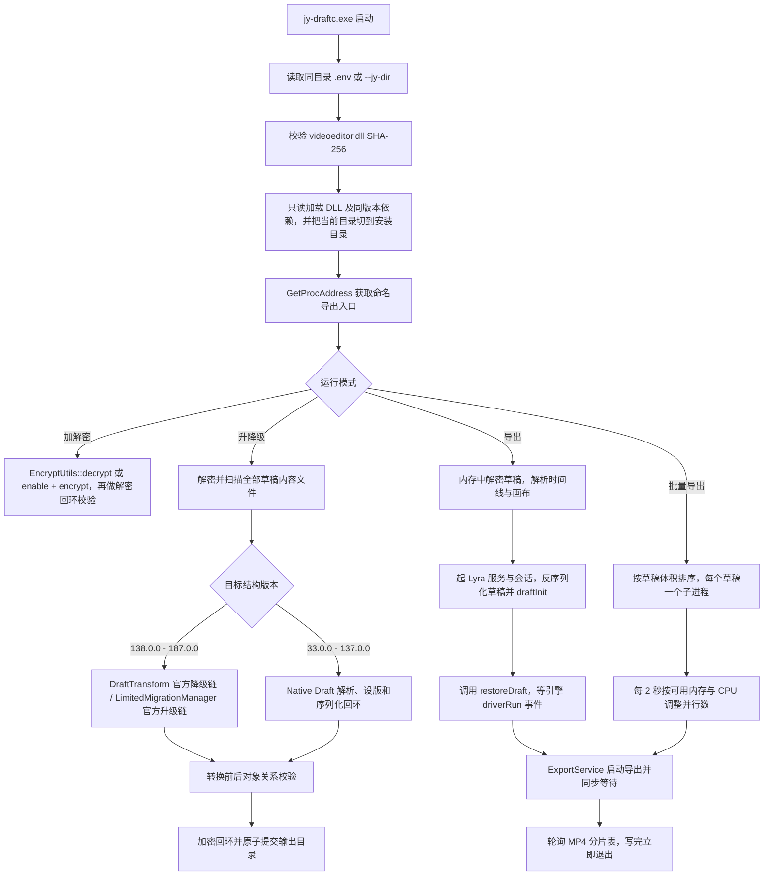

# jy-draftc

`jy-draftc` 是一个用于处理剪映 Windows 端草稿的命令行工具。
目前已支持功能：草稿内容加解密、草稿结构版本升降级、草稿无头导出。

---

## 适用的版本

#### 下表为项目版本、运行时剪映版本、草稿结构版本、APP版本的关系对照表
`（每个剪映版本仅可使用适配其版本的工具，请选择你需要的版本进行下载）`

| 项目版本 | 运行时剪映版本 | 支持的草稿结构版本 | 对应的剪映APP版本 | 文档 | 备注 |
| --- | --- | --- | --- | --- | --- |
| 11.5.0.14471-26101113 | 11.5.0.14471 | 33.0.0 - 187.0.0 | 1.7.0.3739 - 11.5.0.14471 | [查看](src/11.5.0.14471/README.md) |  |


##### 更新时间：2026-10-11 13:09:00 UTC+8

##### 注意：仅对`正式版`的剪映`进行适配`，`测试版`均`不进行适配`

#### ✋ 如需要指定的剪映版本的安装包，推荐从官方渠道获取
`（请先修改命令中的版本号和下载路径后，执行此命令）`
```cmd
winget download --id ByteDance.JianyingPro --exact --version 11.5.0.14471 --download-directory "D:\xxx\xxx"
```


---

## 快速开始

<details>

<summary>查看详情</summary>

### 准备

1. 下载 Windows amd64 分发包并解压，目录里有：

```text
jy-draftc.exe
README.md
USAGE.txt
.env.example
SHA256SUMS.txt
```


2. 打开 PowerShell，复制配置模板并填上剪映安装目录：

```powershell
cd 解压路径
cp .env.example .env
```

```env
#这个目录下面必须能找到 videoeditor.dll
JY_INSTALL_DIR=你的剪映安装目录
```

##### 如不使用 `.env` ，也可以在每条命令中用 `--jy-dir` 指定安装目录，命令行优先级更高。`.env` 里留空的值一律忽略，除 `JY_INSTALL_DIR` 外还支持导出默认值（见 `.env.example`）。

### 开始使用

##### 不指定输出路径时，`-dc` 默认在草稿同级目录内生成 `草稿名-plain\` 副本，`-ec` 生成 `草稿名-enc\`
##### 已支持直接输入草稿目录，而无需指定具体的json文件

#### 体检：

```powershell
.\jy-draftc.exe -c "D:\JianyingPro Drafts\xxx\draft_content.json"
```

#### 解密草稿：

```powershell
.\jy-draftc.exe -dc "D:\JianyingPro Drafts\xxx"
```

#### 回加密：

```powershell
.\jy-draftc.exe -ec "D:\JianyingPro Drafts\xxx-plain"
```

#### 一次解密多个草稿，统一输出到指定目录：

```powershell
.\jy-draftc.exe -dc "D:\JianyingPro Drafts\xxx1" "D:\JianyingPro Drafts\xxx2" -o D:\plain
```

##### 也可以直接给 `装着多个草稿的父目录` ，工具会把里面的草稿逐个展开：

```powershell
.\jy-draftc.exe -dc "D:\JianyingPro Drafts" -o D:\plain
```

##### 或者用英文逗号写多个json：

```powershell
.\jy-draftc.exe -dc "a\draft_content.json,b\draft_content.json" -o D:\plain
```

#### 导出成片：

```powershell
.\jy-draftc.exe -ex "D:\JianyingPro Drafts\xxx" -o D:\out\xxx.mp4 --size 720x1280
```

##### 不指定输出路径时，程序会在源草稿的同级目录生成：

```text
xxx.mp4
```

##### 批量并行导出（`-j auto` = 按可用内存和 CPU 自己决定并行数）：

```powershell
.\jy-draftc.exe -ex "D:\JianyingPro Drafts" -o D:\out -j auto
```

##### 只看计划，不进行处理：

```powershell
.\jy-draftc.exe -ex "D:\JianyingPro Drafts" -o D:\out --dry-run
```

#### 升降级草稿结构版本：

```powershell
.\jy-draftc.exe -dg "D:\JianyingPro Drafts\xxx" -t 179.0.0
.\jy-draftc.exe -ug "D:\JianyingPro Drafts" -t 187.0.0 -o D:\up
```

#### 输出详细诊断日志：

```powershell
.\jy-draftc.exe -ex "D:\JianyingPro Drafts\xxx" --debug
.\jy-draftc.exe -ex "D:\JianyingPro Drafts\xxx" --debug *> debug.log
```
##### 它会输出参数、DLL 校验、ABI 入口、内容文件、版本比较、迁移步骤、结构校验、还原事件、临时目录及异常退出信息，但不会输出草稿 JSON 正文或加密数据。路径中有空格时，需要用英文双引号包住完整路径。

### 使用规则

- 位置参数可以给草稿目录，也可以给单个文件；`-dc`/`-ec`/`-ex`/`-ug`/`-dg` 都接受多个输入（空格分隔，`-dc`/`-ec` 也认英文逗号）。
- 只给一个 `装着多个草稿的父目录` 时，里面每个含内容文件的子目录各算一个草稿。
- 多个输入时，`-o` 必须是目录（作为根目录）；单个输入时，`-o` 是精确路径。
- 输出已经存在时默认停止并提示加 `-f`；只有单个输入的 `-ex` 会直接覆盖同名文件。
- 结构版本对照范围为 `33.0.0 - 187.0.0`，即 `1.7.0.3739` 至 `当前版本`；低于 `137.0.0` 的旧结构未逐版验证，程序也不对源版本设下界。
- `-dg` 必须给 `-t`，所有待处理内容文件的版本都不能低于目标版本；`-ug` 省略 `-t` 时用本包版本，所有内容文件的版本都不能高于目标版本。
- 任何内容文件解析、迁移或校验失败时，都不会提交输出草稿，原草稿保持不变。
- `--debug` 只增加诊断输出，不改变转换、校验和数据安全规则。

</details>


---

## 命令与参数

<details>

<summary>查看详情</summary>

### 命令

| 命令 | 长写法 | 作用 | 输入 |
| --- | --- | --- | --- |
| `-dc` | `--decrypt`（`-d`） | 解密草稿内容文件 | 草稿目录 或 json，**可给多个** |
| `-ec` | `--encrypt`（`-e`） | 明文回加密成剪映能读的形态 | 明文 json 或 `-plain` 目录，**可给多个** |
| `-ex` | `--export` | 渲染导出 MP4 | 草稿目录 或 `draft_content.json`，**可给多个**（并行） |
| `-ug` | `--upgrade` | 升级草稿结构版本 | 草稿目录，**可给多个** |
| `-dg` | `--downgrade` | 降级草稿结构版本（必须给 `-t`） | 草稿目录，**可给多个** |
| `-c` | `--check` | 自检（入口 / ABI / 回环 / 草稿读写） | 可选草稿样本 |
| `-v` | `--version` | 版本与绑定信息 | — |
| `-h` | `--help` | 帮助 | — |

### 参数

| 参数 | 适用 | 说明 |
| --- | --- | --- |
| （位置参数） | 全部 | 草稿目录或文件；可给多个（空格分隔，`-dc`/`-ec` 也认英文逗号），也能直接给装着多个草稿的父目录 |
| `-o, --out <路径>` | 全部 | 输出路径；给多个输入时必须是目录，每个输入写成 `<输出目录>\<输入名>`（json 输入写成 `<输出目录>\<所在文件夹名>\<文件名>.dec.json`）；省略时都写在输入旁边，不动源 |
| `-t, --to <版本>` | `-ug`/`-dg` | 目标版本：结构版本 `179.0.0` 或剪映版本 `11.4.2` 都认；**可重复**，第 i 个对应第 i 个输入（少给的沿用最后一个） |
| `--jy-dir <目录>` | 全部 | 剪映安装目录（优先于 `.env`；别名 `--install-dir`） |
| `--size 720x1280` | `-ex` | 画布尺寸，默认取草稿画布；`--width`/`--height` 可单独指定宽或高 |
| `--fps N` | `-ex` | 帧率，默认 30 |
| `--bitrate N` | `-ex` | 码率，接受 `12M` / `8000K` / `12000000` |
| `--codec h264\|hevc` | `-ex` | 编码器，默认 h264 |
| `--quality/--color-space/--mp4/--hard-encode N` | `-ex` | 引擎内部开关，默认 0 |
| `--timeout N` | `-ex` | 渲染超时上限秒数，默认 900（`--wait` 为别名）；MP4 一写完就退出 |
| `-f, --force` | 全部 | 允许覆盖已存在的输出（默认拒绝覆盖） |
| `--dry-run` | `-ex`/`-ug`/`-dg` | 只列计划，不起引擎；`-ex` 仍要求能读到 `videoeditor.dll`，计划里的 `(N MB)` 是草稿目录体积 |
| `-vv, --verbose` | 全部 | 打印引擎日志，引擎行前缀 `[ve] <file>:<line> \| L<级别> \| <函数> \| <标签> \| <正文>`（本程序自己的诊断行前缀是 `##`）；引擎噪音在控制台上默认自动隐藏 |
| `--debug` | 全部 | 实时打印详细执行日志（阶段、入口地址、字节数、返回码），用于定位具体卡在哪一步 |
| `-q, --quiet` | 全部 | 强制隐藏引擎噪音（输出重定向到文件时的默认行为是保留引擎日志，`-q` 可强制关掉） |
| `-j, --jobs [auto\|N]` | `-ex` | 并行导出数，默认 `auto`（按可用内存和 CPU 自己定）；也可以写死 `-j 3` |
| `--max-jobs N` | `-ex` | 并行数上限（`auto` 时生效），默认物理核数 |
| `--mem-reserve N` | `-ex` | 给系统留出的内存 MB，默认 1024 |
| `--cpu-target N` | `-ex` | CPU 占用目标百分比，默认 90；达到目标即不再增加并行，连续两个采样窗超过 95% 则减半 |
| `--stagger N` | `-ex` | 相邻子进程的启动间隔毫秒，默认 300 |
| `--order size\|name\|input` | `-ex` | 开工顺序，默认 `size`：草稿体积大的先做，缩短总时长 |
| `--log-dir <目录>` | `-ex` | 子进程日志目录，默认 `%TEMP%\jy-draftc-<pid>`；全部成功就删，失败或显式指定则保留 |
| `--only <glob>` / `--skip <glob>` | `-ug`/`-dg` | 只处理 / 跳过匹配的内容文件（可重复），例如 `--skip *.bak` |
| `--plain` / `--encrypted` | `-ug`/`-dg` | 强制输出明文 / 加密形态（默认与输入保持一致） |

### 批量与并行

<details>

<summary>查看详情</summary>

`-dc`/`-ec`/`-ex`/`-ug`/`-dg` 都接受多个路径，也可以只给一个「装着多个草稿的父目录」。多个输入时 `-o` 是根目录（`<输出目录>\<草稿名>.mp4`、`<输出目录>\<草稿名>-179.0.0\`）；单输入时 `-o` 仍是精确路径。

升降级批量时，引擎只加载一次，逐个草稿转换；单个草稿失败不影响其它草稿，结束后打印 `done : N drafts converted` / `error: N of M drafts failed`，退出码取第一个失败的。目标版本可以用重复的 `-t` 逐个指定。`--only`/`--skip` 按草稿内相对路径过滤内容文件（`*.json`、`Timelines\*\draft_content.json` 这类 glob）。

导出时，每个草稿一个子进程。`-j auto`（默认）从 1 个开始，每 2 秒采样一次：可用内存够（`(可用内存 - --mem-reserve) / 实测单草稿峰值`）、CPU 低于 `--cpu-target` 就往上加；内存余量不足就减，连续两个采样窗 CPU 超过 95% 则减半；上限是物理核数与 `--max-jobs` 的较小值，单草稿峰值按实测自动校准。

并行时每个草稿单独写日志，屏幕上只给失败草稿的日志尾部；日志目录在全部成功时自动删除，有失败（或给了 `--log-dir`）就保留并打印路径，加 `-f` 重跑该草稿即可。

实测（16 核 / 16 GB，171 秒 720x1280 草稿，单草稿峰值 1.3 GB）：


| 场景 | 墙钟 | 加速比 |
| --- | --- | --- |
| 单草稿 | 63 s | — |
| 2 个草稿 `-j 2` | 62 s | 1.99x |
| 4 个草稿 `-j auto` | 75 s | 3.59x |
| 4 个草稿 `-j 4` | 71 s | 3.91x |

##### 其中单草稿的 63 s = 引擎还原草稿约 0.5 s + 渲染约 60 s。`auto` 比 `-j 4` 慢 4 秒，是它从 1 档起、每 2 秒采样逐档爬升的开销。

</details>

### 退出码

```text
0  成功                          2  导出失败（引擎没产出可用 MP4）
8  DLL 缺失 / 版本不符           9  入口缺失或 ABI 校验失败
10 解析或序列化被拒             11 加解密回环失败
12 结构 / 身份 / 对象关系校验失败 14 目录或版本无效
15 方向无效（升级给了更低目标 / 降级给了更高目标）
16 降级链失败                   17 升级链失败
18 元数据校验失败               64 命令行参数错误
1  其他
```

</details>


---

## 从源码构建

<details>

<summary>查看详情</summary>

#### 当前源码使用 C++20、Windows API 和 MSVC C++ ABI，仅支持 Windows x64。

### 构建环境

需要准备：

```text
Visual Studio（Desktop development with C++，脚本用 `VS_ROOT` 或 vswhere 定位）
MSVC x64 工具链
适配版本的剪映 安装目录
```

### 强化 Release 全量构建

进入项目根目录并执行构建脚本：

```powershell
cd 项目根目录
.\build.bat
```

##### 脚本默认调用 `cl.exe` 编译 `src\11.5.0.14471\` 下的全部源文件（如需编译其他版本，则需手动修改路径）

当前 Release 构建启用了：

```text
/std:c++20 /O2 /Oi /GL /Gy /Gw /GR- /MT /EHsc /GS /guard:cf /DNDEBUG /utf-8 /W4 /permissive-
/LTCG /INCREMENTAL:NO /SUBSYSTEM:CONSOLE /OPT:REF /OPT:ICF /guard:cf bcrypt.lib
```


### 生成发布产物

```powershell
.\scripts\package.ps1
```

脚本内部先跑 `build.bat` 并校验编译结果，再在 `dist\<包名>\` 暂存目录内复制文件、用 `-h` 生成 `USAGE.txt`、生成 `SHA256SUMS.txt`，压缩成 zip 后删除暂存目录。

最终 `dist` 目录包含：

```text
dist\
  jy-draftc-<剪映版本号>-<打包时间>-windows-amd64.zip
```

##### 包名格式为 `jy-draftc-<剪映版本号>-<打包时间>-windows-amd64.zip`，`<打包时间>` 为打包时刻的 `yyMMddHH`（8 位，例 `26101113`）。

| 产物内容 | 说明 |
| --- | --- |
| `jy-draftc.exe` | 主程序 |
| `README.md` | 本文件 |
| `USAGE.txt` | 由 `jy-draftc.exe -h` 实时生成的英文用法 |
| `.env.example` | 配置样例 |
| `SHA256SUMS.txt` | 包内各文件的 SHA-256 |


### 校验发布文件

```powershell
$zip = ".\dist\jy-draftc-<剪映版本号>-<打包时间>-windows-amd64.zip"
(Get-FileHash $zip -Algorithm SHA256).Hash; Expand-Archive $zip .\verify -Force; Get-Content .\verify\SHA256SUMS.txt
```

### 解压后的运行目录

```text
jy-draftc.exe
README.md
USAGE.txt
.env.example       （复制为 .env 后填写 JY_INSTALL_DIR）
SHA256SUMS.txt
```

程序只从 `.env` / `--jy-dir` 指向的剪映安装目录加载运行时。

</details>


---

## 流程

<details>

<summary>查看详情</summary>



### 草稿版本处理

| 版本区间 | 处理方式 |
| --- | --- |
| 33.0.0 - 137.0.0 | 使用 DLL 导出的 Draft 解析、版本设置和序列化入口 |
| 138.0.0 - 187.0.0 降级 | 使用 `DraftTransform` 内置转换链 |
| 138.0.0 - 187.0.0 升级 | 使用 `CreateLimitedMigrationManager` 内置迁移链 |

从低于 `137.0.0` 的版本升级到更高版本时，程序先通过 Native Draft 接口归一到 `137.0.0`，再进入 DLL 的正式结构升级链。

### 当前使用到的导出入口

| 入口 | 作用 |
| --- | --- |
| `EncryptUtils::decrypt` | 解密剪映草稿内容 |
| `EncryptUtils::enable` / `encrypt` | 打开 DLL 内部加密开关并重新加密草稿内容 |
| `DraftTransform` 构造和析构入口、`SetWorkspace`、`transform` | 官方降级转换链 |
| `CreateLimitedMigrationManager` | 创建官方升级迁移管理器 |
| `GetDraftFromJson` / `GetJsonFromDraft` | Native Draft 解析与序列化 |
| `Draft::set_new_version` | 设置兼容结构区间内的目标版本 |
| `Error::get_code` / `Error::get_msg` | 校验迁移回调结果 |
| `Logger::getLogger` / `setAlogFunction` / `setLogLevel` | 接管引擎日志通道，还原完成事件靠它判定 |
| `Server::instance` / `startup` / `openSession` / `getSession` | 起本地服务与会话 |
| `ProjectService` / `DraftService::draftInit` / `draftTransaction` | 建工程请求、初始化草稿、提交时间线 |
| `operator new` / `vt_request` / `vt_control` / `restore_draft` / `export_factory`（按 RVA 绑定） | 对象分配、虚表接管、还原草稿、创建导出服务对象 |

除上述五个无导出名的入口按 RVA 绑定外，其余入口都通过 `GetProcAddress` 动态获取。


</details>


## 使用边界与免责声明

```
使用者应遵守所在地法律法规和相关软件用户协议，仅处理自己有权访问和修改的本地草稿文件。任何违法、侵权或未授权使用行为，均与项目作者无关。
使用本项目造成的任何数据损坏、软件异常、账号风险、法律纠纷或其他后果，均由使用者自行承担。重要草稿在处理前仍应保留独立备份。
```


## 支持与鸣谢

### ❤️ 感谢 [Linux.do](https://linux.do/) 站点及其社区为项目开发和交流提供支持

### ✅ MacOS版本 jy-draftc-mac
#### &nbsp;&nbsp;&nbsp;&nbsp;&nbsp;&nbsp;&nbsp;&nbsp;感谢&nbsp;[@vhly](https://github.com/vhly)&nbsp;贡献的适用于MacOS的软件版本
#### &nbsp;&nbsp;&nbsp;&nbsp;&nbsp;&nbsp;&nbsp;&nbsp;[阅读文档](./jy-draftc-mac/README.md)

### ✅ GUI版本 jy-draft-port
#### &nbsp;&nbsp;&nbsp;&nbsp;&nbsp;&nbsp;&nbsp;&nbsp;由&nbsp;[@zzz1999](https://github.com/zzz1999)&nbsp;创建和维护的带GUI的软件版本
#### &nbsp;&nbsp;&nbsp;&nbsp;&nbsp;&nbsp;&nbsp;&nbsp;提供了可视化操作，使操作更加简单
#### &nbsp;&nbsp;&nbsp;&nbsp;&nbsp;&nbsp;&nbsp;&nbsp;[传送至 jy-draft-port](https://github.com/zzz1999/jy-draft-port)

## 许可证

#### ✅ [MIT License](LICENSE) (c) 2026 wenshui330
