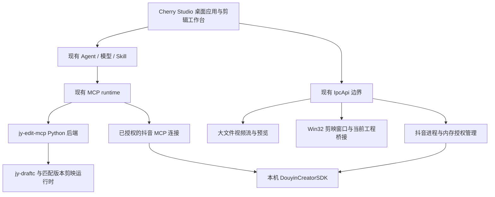

# Cherry Studio 底座迁移方案

状态：用户已于 2026-10-26 批准实施。开发版已实现并完成本地集成验证；真实账号/剪映工程验收及 Windows 安装包尚未完成。当前进展与限制见 [实施状态](../desktop/STATUS.md)。

## 目标与范围

以 Cherry Studio 为桌面应用底座，将本仓库的剪辑、视频预览、剪映工程联动、抖音账号能力接入同一应用。2026-10-26 用户已确认完整范围。

保留 Cherry Studio 的模型供应商配置、对话、Agent、MCP、Skill、文件与任务能力。原子剪辑工具继续由 Python MCP 提供，剪辑流程继续通过 Skill 组合。首个目标平台为 Windows x64；剪映原生能力不能因底座跨平台而宣称支持 macOS/Linux。

## 已核对的源码基线

| 项目 | 当前状态 | 处理方式 |
| --- | --- | --- |
| 当前仓库 | HEAD `4f705a972da3f042a79dabc8b778e95d31af0a0f`，包含已有未提交的 Python、yoyoking、原生桥接改动 | 原地保留；迁移不覆盖、清理或回退这些文件 |
| Cherry Studio | `package.json` 版本 `2.1.8`；上游提交 `de8d659dbe23753fe62e86330483c10c88007566` | 固定此源码快照，升级上游另行验证 |
| 上游本地目录 | `G:\project\jy-draftc\cherry-studio` | 独立 Git checkout；分支 `feat/yoyoking-integration-spec`，保留上游历史边界 |
| 开发工具 | 上游要求 Node `>=24.12.0`、pnpm `12.6.0`；本机分别为 `24.15.0`、`12.6.0` | 已安装锁定依赖并完成开发版构建 |

`cherry-studio` 是父仓库忽略的可重建 checkout，不作为隐含 gitlink 提交。父仓库以 `desktop/upstream.json`、`desktop/cherry-studio.patch` 和校验回执保存固定基线及增量；准备脚本已经在独立干净 checkout 上验证。后端源码继续由当前仓库持有。

## 应用结构

### 1. 桌面应用与剪辑工作台

新增“剪辑工作台”入口，布局为会话区、素材/工程区、视频/原生剪映区。会话沿用现有 Agent 与工具调用链；工作台展示真实返回的工程、revision、快照、导出任务状态和错误。

应用暂用 `Yoyoking Studio` 名称，独立 appId、协议和用户数据目录；最终品牌名称可后续调整。新应用不读取或迁移现有 Cherry Studio / Harness 的用户 Profile、密钥或登录态。派生应用不能沿用上游官方自动更新源；未配置自有更新发布链前，关闭自动更新安装入口。

界面使用上游 `@cherrystudio/ui`、Tailwind 和 i18n。主进程资源统一纳入 `BaseService` 生命周期和 path registry；不增加独立的全局 IPC 通道或重复的 Agent 容器。

### 2. 剪辑 MCP 与 Skill

复用 `src/jy_edit_mcp`、`pyproject.toml`、`uv.lock` 和原生转换器。开发阶段允许指向本仓库，发行包必须携带固定版本后端及所需启动资源，不能依赖开发机绝对路径或 `.venv`。

通过 Cherry Studio 现有 `McpRuntimeService` / `McpServerService` 创建和管理本地 stdio MCP，并只关联到剪辑 Agent。Skill 使用现有 `SkillService` 安装和关联；将 Harness 专有工具前缀、预览调用与工具名发现方式改为新宿主实际契约，不能原样复制提示词后声称可用。

保留素材白名单、workspace、revision 冲突、native_ref、操作回执、分页及秒/微秒单位。读取真实工具目录核对能力，不依赖旧文档里的固定数量。原生导出需要匹配版本 `videoeditor.dll`，不能把本机另一版本剪映的窗口接入成功当作导出兼容。

### 3. 视频预览

复用现有 `yoyoking/video-preview.js` 中已验证的路径与 Range 语义，但移除 Harness 工具注册依赖。播放器支持本地素材和已完成导出的视频、播放/暂停、拖动、音量和全屏。

上游 `MediaProtocolService` 当前主要存放内存 Buffer，音频支持 Range；不能直接将整段 MP4 读入内存冒充大文件流。应在该协议内增加受授权、文件流式的 Video entry，复用现有窗口来源验证和所有权释放机制，避免另起无鉴权的文件 HTTP 服务。需要针对 GET/HEAD、206/416、拖动、释放后拒绝读取及符号链接越界做回归。

### 4. 剪映窗口与当前工程

复用 `scripts/jianying-window-poc/window-host.cpp`、窗口选择逻辑、`current-project.js` 的锁持有者与稳定快照校验；将 Harness 的 pane、宿主句柄、焦点和生命周期事件改接到 Electron 窗口与工作台视口。

多窗口明确选择 PID/HWND，禁止默认选第一项或按修改时间猜工程。关闭页签、切换会话、应用正常退出和宿主失联需要恢复原窗口。新底座必须重新验收缩放、跨屏、最小化、弹窗、空格播放、中文输入和窗口恢复。

“读取当前工程”仍表示最近保存的磁盘快照，保留 `last_saved_disk_snapshot`、`unsaved_changes=unknown`、主时间线和源哈希证据。编辑默认生成副本。后台修改成功不表示剪映 UI 已切换到副本，也不能把 native draft_id 当作 MCP project_id。

### 5. 抖音账号

从现有 `douyin-host.js`、`douyin-process.js`、`douyin-oauth.js`、`douyin-service.js` 和 `douyin/managed_server.py` 提取无 Harness 依赖的托管能力，通过 Cherry 生命周期服务持有一个应用内共享登录。

账号面板提供启动状态、官方登录、连接状态、退出与失败重试。授权由用户在官方窗口完成；凭据留在内存，不复制旧 vault、浏览器 Profile 或 `.env`。SDK 缺失不阻断剪辑。关闭聊天保留应用内登录，应用退出释放自有服务；退出连接清除共享授权并撤下关联业务工具。

MCP 传输优先复用 Cherry 现有 OAuth/HTTP 扩展点，先核对 state、PKCE、resource、刷新和会话隔离契约；如现有接口不足，改进该扩展点。不得将一次性 access token 写入持久化 MCP headers 作为替代。沿用串行、至少 5 秒间隔与原 SDK 的限页行为；保持现有数据、下载与导出范围，不扩展到发布或互动写操作。

## 源码归属与落点

| 当前来源 | 目标落点/接入边界 |
| --- | --- |
| `src/jy_edit_mcp`、Python 锁文件、原生工具 | 保留当前后端权威源码；桌面运行时资源由构建流程显式准备和校验 |
| `yoyoking/index.js`、`client.js`、`cordis.patch.yml` | 不作为 Cherry 插件直接加载；由新工作台、IPC 和现有 Agent API 替代宿主适配部分 |
| 预览与抖音通用逻辑 | 目标 `src/main/features/yoyoking/`，消除 Harness 依赖并保留原有接口行为测试 |
| 窗口桥接与当前工程逻辑 | 目标 `src/main/features/yoyoking/` 及打包后的 Win32 helper |
| 工作台界面 | 复用组件位于 `src/renderer/components/yoyoking/`，由 `src/renderer/routes/app/yoyoking.tsx` 与 Agent 右侧面板共同使用 |
| 跨进程命令 | 目标 `src/shared/ipc/schemas/` 与 `src/main/ipc/handlers/` 的 yoyoking domain |
| 配置、临时状态、业务数据 | 分别使用 Preference、Cache、现有 DataApi；不再造同类存储 |

## 实施与验收顺序

| 阶段 | 实现 | 通过标准 |
| --- | --- | --- |
| S1 底座 | 固定上游、可复现源码布局、独立应用身份/数据目录、开发启动、剪辑工作台入口 | Electron 实际启动，工作台可进入；现有用户数据不变 |
| S2 剪辑闭环 | 环境诊断、MCP 注册、剪辑 Agent、3 个剪辑 Skill、素材/工程/任务展示 | 真实工具发现和 Skill 装载；合成素材创建工程、编辑、快照、导出、任务终态与 ffprobe 核验 |
| S3 预览 | 文件流 Video entry、播放器与导出结果联动 | 大文件 Range/HEAD、鼠标拖动、播放暂停、拒绝越界与释放后读取；真实窗口观察 |
| S4 原生联动 | Windows helper、选择/接入/恢复、当前工程读取、副本打开流程 | 独立测试草稿真实播放、输入、保存重开；源哈希保持不变；退出恢复原窗口 |
| S5 抖音 | 应用级托管、官方登录面板、共享登录、MCP 授权接入、抖音 Skill | 合成 OAuth/生命周期回归后，由用户完成真实授权；真实工具发现、有界只读调用、下载/Excel 内容回读与注销检查 |
| S6 发行 | 打包后端/helper/Skill、资源清单和哈希、Windows 分发包、启动说明 | 打包应用从独立目录启动，全流程重新验收；记录签名状态，未签名必须标注 `NotSigned` |

每阶段完成实现、适用测试和真实运行检查后再进入下一阶段。某阶段失败保留回执与其他已完成能力，不将工具列表、测试夹具或构建成功计作完整 E2E。

## 依赖与交付边界

Cherry 底座保留其 AGPL-3.0 许可证与归属文件，当前 MIT 来源保留原声明。DouyinCreatorSDK 当前作为用户提供的本机外部运行时，不随包复制其代码、凭据或账号数据；发行时单列组件清单。

实际剪映启动、工程选择和抖音官方授权属于后续实机验收步骤；需要用户参与时只请求必要操作。当前阶段未启动剪映、未改动原工程、未访问抖音业务接口、未安装或替换用户桌面应用。

## 当前已完成与待完成

- 已完成：源码基线与 Spec 审阅、独立开发版、四类能力的宿主接入、自动化回归、隔离 Electron 合成剪辑/导出/预览和 Win32 窗口 fixture、真实 SDK 服务启动及元数据验证、可复现源码补丁。
- 待完成：真实模型对话、真实剪映工程交互、抖音官方账号授权及业务输出、Windows 发行包。具体缺项和已知单视频轨导出问题见实施状态。

上游 `AGENTS.md` 指向 `CLAUDE.md`，其中要求 substantial feature/architecture 工作先取得 approved proposed Spec。用户已明确回复“确认”授权按本方案实施；双语 Spec 仍保持 `proposed`，因为尚未满足全部真实验收标准。

## 核对依据

- 上游：[固定源码](https://github.com/CherryHQ/cherry-studio/tree/de8d659dbe23753fe62e86330483c10c88007566)、[开发约定](../cherry-studio/CLAUDE.md)、[Spec 流程](../cherry-studio/.agents/notes/README.md)。
- 底座：[MCP runtime](../cherry-studio/src/main/ai/mcp/McpRuntimeService.ts)、[SkillService](../cherry-studio/src/main/ai/skills/SkillService.ts)、[IpcApi](../cherry-studio/docs/references/ipc/README.md)、[媒体协议](../cherry-studio/src/main/services/mediaProtocol/README.md)。
- 当前能力：[剪辑后端](jy-edit-mcp.md)、[yoyoking](../yoyoking/README.md)、[原生桥接](../scripts/jianying-window-poc/harness-plugin/README.md)。
- Proposed Spec：[中文](../cherry-studio/.agents/notes/proposed/architecture/2026-10-26-yoyoking-desktop-integration.zh.md)、[English](../cherry-studio/.agents/notes/proposed/architecture/2026-10-26-yoyoking-desktop-integration.md)。
